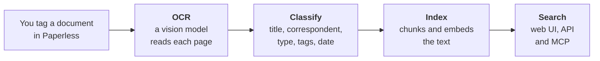

# Paperless-ngx AI

AI for your [Paperless-ngx](https://github.com/paperless-ngx/paperless-ngx) archive. It reads the text off your scans, files each document with a title, correspondent, type and tags, and answers questions about the whole archive: ask *"when does my passport expire?"* and get the answer, with links to the documents it came from.

It runs as containers beside your Paperless, with OpenAI or a local Ollama.

[](https://hub.docker.com/r/rossetv/paperless-ai)
[](https://github.com/rossetv/paperless-ai/actions)

## How it works

One image, four services. Run only the ones you want.



| Service | Command | What it does |
|:---|:---|:---|
| OCR | `paperless-ai` (default) | Transcribes documents tagged for OCR and writes the text back to Paperless. PDFs that already contain text are passed straight on. |
| Classifier | `paperless-classifier-daemon` | Fills in title, correspondent, document type, tags, date, language and person. |
| Indexer | `paperless-indexer-daemon` | Keeps a local search index in step with Paperless. |
| Search | `paperless-search-server` | Serves the web UI, a JSON API and an MCP endpoint on port 8080. |

OCR and classification hand documents to each other through Paperless tags, so a document's tags always show where it is. The indexer and search server add search on top.

## Quick start

You need a running Paperless-ngx, its API token (*Settings → Users & Groups → API Token*), and an OpenAI API key.

**1. Create three tags in Paperless:** one for documents to OCR, one for OCR done, one for errors. Note their numeric IDs, listed at `http://your-paperless:8000/api/tags/`.

**2. Save this as `docker-compose.yml`**, with your Paperless address and tag IDs filled in:

```yaml
x-paperless-ai: &paperless-ai
  image: rossetv/paperless-ai:latest
  restart: unless-stopped
  volumes:
    - paperless-ai-data:/data
  environment:
    PAPERLESS_URL: http://paperless:8000
    PAPERLESS_TOKEN: ${PAPERLESS_TOKEN}
    OPENAI_API_KEY: ${OPENAI_API_KEY}
    PRE_TAG_ID: "443"      # documents to OCR
    POST_TAG_ID: "444"     # OCR done; the classifier picks these up
    ERROR_TAG_ID: "552"    # something went wrong

services:
  ocr:
    <<: *paperless-ai

  classifier:
    <<: *paperless-ai
    command: paperless-classifier-daemon

  indexer:
    <<: *paperless-ai
    command: paperless-indexer-daemon

  search:
    <<: *paperless-ai
    command: paperless-search-server
    ports:
      - "8080:8080"

volumes:
  paperless-ai-data:
```

**3. Start it**, with your secrets in a `.env` file beside it:

```bash
printf 'PAPERLESS_TOKEN=...\nOPENAI_API_KEY=sk-...\n' > .env
docker compose up -d
```

**4. Create your admin account.** On first start the search server prints a one-time setup token:

```bash
docker compose logs search | grep "SETUP TOKEN"
```

Open `http://localhost:8080/setup`, paste the token and choose a username and password.

**5. Try it.** Tag a document with your OCR tag. Within a minute its text appears in Paperless, then its title and tags, then it becomes searchable in the web UI.

Every service must share the same `/data` volume: it holds the settings, user accounts and search index.

## Settings

After the first start, change settings in the web UI under **Settings**. A change reaches every service within seconds, with no restart. The environment variables in `docker-compose.yml` only seed the first start.

Every setting and its default is listed in [docs/configuration.md](docs/configuration.md).

## Running locally with Ollama

Point every step at Ollama, embeddings included, and no OpenAI key is needed:

```yaml
    LLM_PROVIDER: ollama
    EMBEDDING_PROVIDER: ollama
    OLLAMA_BASE_URL: http://ollama:11434/v1/
    EMBEDDING_MODEL: nomic-embed-text
    EMBEDDING_DIMENSIONS: "768"
```

The default models are `gemma3:27b` and `gemma3:12b`; pull them in Ollama first. Changing the embedding provider or model later needs a full re-index from the **Index** page.

## Connecting an AI assistant

The search server is also an [MCP](https://modelcontextprotocol.io) server at `http://your-host:8080/mcp`. Create a key under **Settings → API Keys** with the `mcp` scope, and send it as `Authorization: Bearer sk-pls-…`.

| Tool | Cost | |
|:---|:---|:---|
| `semantic_search` | free | The passages most relevant to a question. |
| `keyword_search` | free | Documents matching exact words or filters. |
| `fetch_documents` | free | The full text of documents by ID. |
| `list_filters` | free | Correspondents, document types and tags to filter on. |
| `deep_search` | LLM calls | The server plans, searches and writes the answer itself. |

The same key, with the `api` scope, works for the JSON API under `/api/`.

## Troubleshooting

`GET /api/healthz` reports the search index's state:

| `status` | Meaning |
|:---|:---|
| `ok` | Ready. |
| `index-not-ready` | The indexer hasn't finished its first pass yet. |
| `index-corrupt` | The index file is damaged. |

The index holds nothing that can't be rebuilt from Paperless. If it is corrupt, stop the indexer, delete `index.db` and `index.db.lock` from the `/data` volume, and start the indexer again. It re-indexes everything; at 10,000 documents that takes a few hours. Accounts and settings live in `app.db` and are untouched.

## Development

```bash
pip install -e . -r requirements-dev.txt
pytest -n auto
ruff check src tests && mypy src

cd web && npm ci
npm run dev        # the web UI, with hot reload
npm test
```
